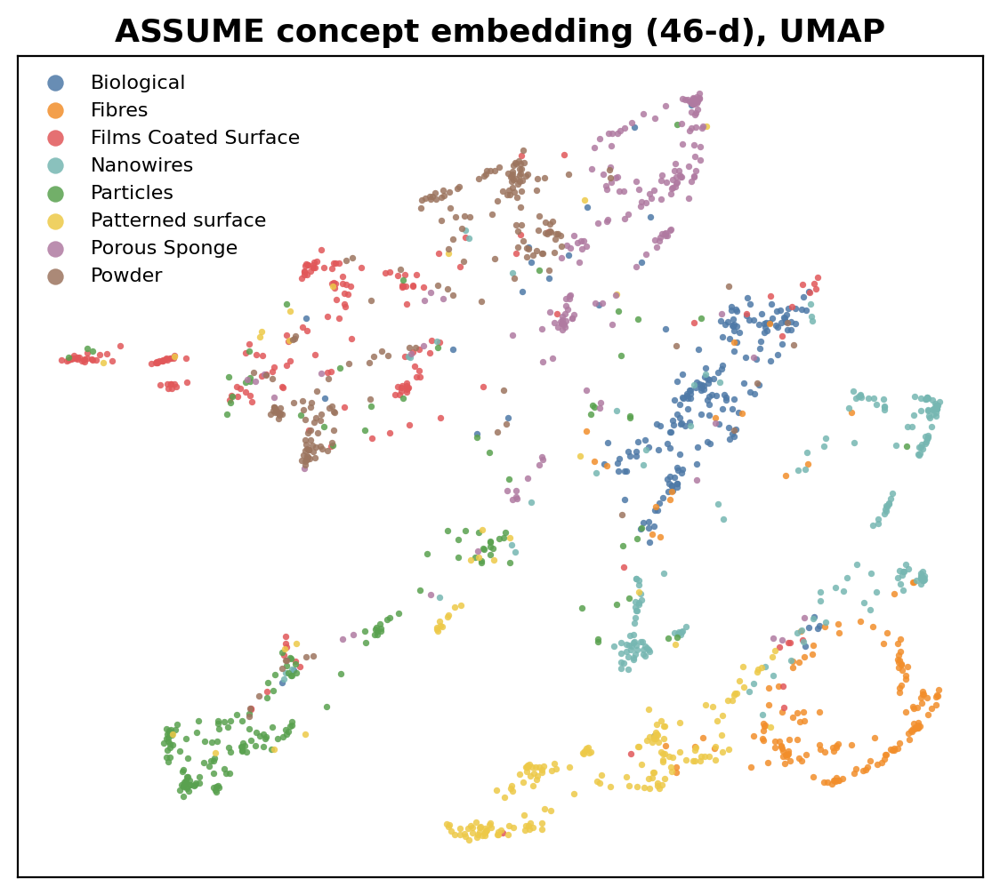
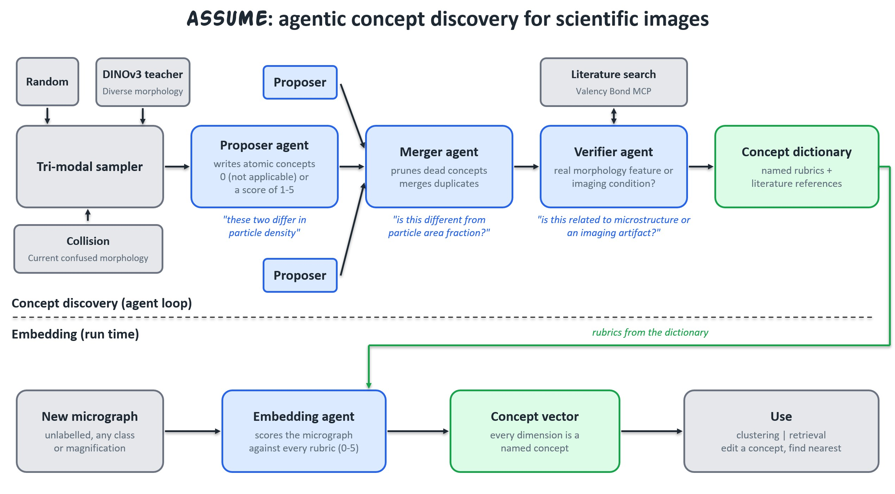

# ASSUME: Auto-Synthesized Semantic Unified Morphological Encoder

ASSUME turns unlabelled scientific images into an embedding whose every dimension is a named, human-readable visual concept. Multimodal LLM agents discover the concepts from the images, check them against the scientific literature, and write a 0–5 scoring rubric for each. An embedding agent then scores any new image against the rubrics. The result is a fully unsupervised, label-free Concept Bottleneck Model: you can read an image's embedding directly, edit one concept to search for images, and audit what a downstream model is using.

It is demonstrated on scanning electron microscopy (SEM) micrographs, but nothing in the pipeline is SEM-specific.



## Pipeline

1. **Proposer agents** (run in parallel) look at small batches of micrographs, chosen by DINOv3-guided active sampling. Each names morphological concepts that separate them and writes a definition and a 0–5 rubric (0 = absent, 5 = dominant).
2. **Merger agent** drops concepts whose scores barely vary and merges strongly correlated concepts after viewing micrographs where they co-occur.
3. **Verifier agent** retrieves papers for each concept through a scientific paper-search MCP server. It keeps intrinsic specimen morphology and prunes instrument or imaging artefacts (charging, focus, contrast).
4. **Embedding agent** scores each micrograph against the final rubrics, producing a 46-dimensional concept vector.



## Results

The run used 1,543 micrographs from 8 morphology classes, out of 14,620 in the dataset. Class labels are never used by ASSUME; they are only used for evaluation.

| Embedding | Dimensions | 5-fold k-NN class accuracy (k = 5) | Interpretable |
|---|---|---|---|
| DINOv3 ViT-S/16+ | 384 | 90.1% ± 2.2 | no |
| ASSUME (verified concepts) | 46 | 85.6% ± 1.7 | yes, every axis is a named concept with a rubric |

- **Concepts explain DINOv3's latent space.** ASSUME concepts can be predicted linearly from DINOv3 features: the best reaches a cross-validated R² of 0.71 (elongation), and the median is 0.51. Painting the DINOv3 UMAP by concept score shows what each region encodes.
- **Two concepts span a dense 2D morphology map.** For example, elongation × occupancy density has 77% of a 10×10 grid populated with at least 3 images. See [`visualizations/concept_planes/`](visualizations/concept_planes/).
- **Single-concept traversals.** Raising one concept while the others stay roughly fixed gives a visible progression; see [`figures/fig_latent_traversal.png`](figures/fig_latent_traversal.png).
- **Retrieval depends less on brightness and contrast.** ASSUME's nearest neighbours vary more in brightness than DINOv3's (mean |Δ| 0.130 vs 0.105; larger for 67% of queries). DINOv3 still retrieves same-class neighbours more often (88% vs 81% of the top 5).

## Repository layout

| Path | Contents |
|---|---|
| `assume/` | The pipeline: agents (proposer, merger, verifier, scorer), Vertex client, sampling, discovery loop, evaluation |
| `scripts/` | Command-line runners for each stage, plus figure and animation scripts |
| `demos/app_microstructure_equalizer.py` | Streamlit app: pick a micrograph, dial concept values, and retrieve matching micrographs |
| `data/micrographs/` | The 1,543 evaluation micrographs downsampled to 384×288 (see Data and licence) |
| `data/real/` | Final concept scores (`assume_embeddings_verified.npy`), evaluation manifest, metrics, UMAP cache |
| `data/verifier/` | Verified concept dictionary with rubrics, literature evidence, verifier decisions |
| `data/dinov3_pooled.npy` | DINOv3 embeddings for all 14,620 micrographs |
| `figures/` | Paper figures and video animations |
| `tests/` | Unit and end-to-end tests (Vertex calls are mocked) |

## Quick start

The ASSUME embeddings and concept latents are uploaded together with the micrographs. Follow these steps to run the demo viewer:

```bash
python -m venv .venv
.venv/Scripts/activate            # Windows; use `source .venv/bin/activate` on Linux/macOS
pip install -r requirements.txt
streamlit run demos/app_microstructure_equalizer.py
```

To regenerate the figures:

```bash
python scripts/concept_plane_thumbnail_grids.py          # 10x10 concept-plane grids
python scripts/make_fig_dino_concepts_and_retrieval.py   # UMAP and retrieval figures
python scripts/make_fig_latent_traversal.py rank          # rank concepts for traversals
```

### Re-running the agents

Copy `.env.example` to `.env` and set `VERTEX_PROJECT_ID` and `VERTEX_API_KEY`. Re-embedding the full dataset also needs the full-resolution images; download them (see below) and set `SEM_DATASET_PATH`.

```bash
python scripts/run_m1_ingest_and_embed.py               # manifest + DINOv3 embeddings
python scripts/run_60_concept_discovery_pipeline.py     # proposer / merger discovery loop
python scripts/run_verifier.py                          # literature verification
python scripts/run_real_scoring.py                      # score the evaluation set
python scripts/apply_verifier_subset.py                 # keep verified concepts, metrics, UMAP
```

### Tests

```bash
python -m unittest discover -s tests -p "test_*.py"
```

## Data and licence

The micrographs come from the SEM dataset of Aversa et al.:

> R. Aversa, M. H. Modarres, S. Cozzini, R. Ciancio, A. Chiusole. *The first annotated set of scanning electron microscopy images for nanoscience.* Scientific Data 5, 180172 (2018). https://doi.org/10.1038/sdata.2018.172

That dataset is released under [CC BY 4.0](https://creativecommons.org/licenses/by/4.0/). `data/micrographs/` holds a modified subset: the 1,543 evaluation images, converted to grayscale and resized to 384×288 by `scripts/make_micrograph_pack.py`. It is redistributed under the same licence.
